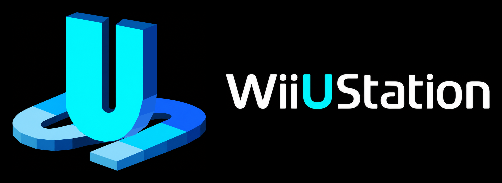

# WiiUStation



**PlayStation (PS1) emulator for the Wii U, based on PCSX-ReARMed.**

A standalone app for the Aroma environment (`.wuhb`). The emulator core is
[PCSX-ReARMed](https://github.com/libretro/pcsx_rearmed), linked into the app
through the libretro API, so RetroArch is not needed. The menu, video,
controllers, covers and saves are WiiUStation's own.

## Install

1. Copy `WiiUStation.wuhb` to `sd:/wiiu/apps/`.
2. Start WiiUStation once. It creates its folder next to the app
   (versions 1.0.0 and 1.0.1 kept it at `sd:/WiiUStation`; it is moved back
   on the first start):

```
sd:/wiiu/apps/WiiUStation/
├── bios/       optional: scph1001.bin, scph5501.bin, ...
├── saves/      memory cards (<game>.srm)
├── states/     save states
├── covers/     downloaded covers (<GAME-ID>.jpg) - you can add your own
├── bezels/     your borders: default.png or <GAME-ID>.png (1280x720)
├── cheats/     libretro .cht files: <game file name>.cht or <GAME-ID>.cht
├── screenshots/
├── gamesettings/  per-game settings
├── db/         game details (downloaded on demand)
├── favorites.txt, recent.txt
├── log.txt     what happened (system, settings, games loaded or not and why, fps, crash reports); last_error.txt: the last game that did not load
└── settings.cfg
```

Your games (.cue/.bin, .chd, .pbp, .iso, .img, .m3u, ...) can be in any
folder of the SD card: the first time, choose it on the start screen, or
later in **Settings → Games folder**. WiiUStation has no games folder of its
own. Without a BIOS, the built-in HLE BIOS is used.

### Games on a USB drive

A **FAT32** USB drive (with Aroma) can hold your games too. When a drive is
detected, **Settings → Games source** lets you choose **SD**, **USB** or
**SD + USB**, with a folder for each. With both, the game list shows them
together (games from the drive are tagged **[USB]**) and the **ZR** filter
can show only one of them. The drive is only read: saves, states and
settings stay on the SD card. If the Wii U asks to format the drive, do not
accept: Aroma's UStealth option (Aroma Base Plugin) hides that dialog.

## Controls

The GamePad, Pro Controller, Classic Controller, Wii Remote (sideways) and
Wii Remote with Nunchuk all work. Players are assigned in this order:
GamePad first, then the other controllers (Settings → Who is player 1 puts
the Wii controllers first). The Wii Remote buttons can be remapped in
Settings → Button mapping.

| Wii U | PlayStation |
|---|---|
| A / B / X / Y | ○ / ✕ / △ / □ |
| L / R / ZL / ZR | L1 / R1 / L2 / R2 |
| Sticks, stick clicks | analog sticks, L3 / R3 (DualShock mode) |
| + / − | Start / Select |

- In a game, **HOME**, **L3 + R3** or **touching the GamePad** opens the menu.
  In the menu, HOME opens the Wii U HOME Menu.
- A Wii Remote also works as a **pointer** in the menus: point at the screen,
  **A** chooses and **B** goes back (Settings → Wii Remote pointer:
  Automatic, On or Off). The GamePad's sensor bar is only on while a Wii
  Remote is connected and in use.
- The menu is built for touch. A single tap opens an item and dragging
  scrolls. In the settings, tap the ◀ ▶ arrows to change a value. **X**
  changes the game browser view: Carousel, Grid, Compact grid or List.

## Features

- **Lightrec** dynarec, running in the Cafe OS codegen (JIT) area.
- **Hi-res speed-up** (on by default): games that draw 640x480 frames run
  much faster by showing every other line. **Direct 16-bit picture** (on by
  default) makes the heaviest menus run at 60 fps.
- **Threaded GPU** on Espresso core 2. Optional threaded sound on core 0.
- **Covers**: the game ID is read from the disc image (SYSTEM.CNF), the PBP
  header, the file name, or the running game (CHD). The cover is downloaded
  over HTTPS from [xlenore/psx-covers](https://github.com/xlenore/psx-covers).
- **Picture**:
  - filters: Smooth, Pixel, Sharp smooth;
  - effects: scanlines, CRT mask;
  - screen: 4:3, stretch, integer scale;
  - borders: **Ambient**, a soft, dimmed copy of the game behind it; 12
    built-in bezels that always fit around the picture, including with Auto
    zoom: tube TVs (Tube TV, Classic TV, Retro TV, with a curved-glass look),
    pixel art (Pixel sky, Pixel city, Pixel castle), Grey console, Carbon,
    Synthwave, Wood, White and Space; or
    **Custom image**, your own PNG bezels.
- **Saves**: memory cards are saved automatically. There are 10 save-state
  slots, each with a thumbnail.
- **Continue where you left off**: the game is saved when you leave it, and
  you are offered to resume when you start it again.
- **Fast forward**: hold R3, press R3 to toggle, or hold ZL+ZR, at 2x, 3x
  or 4x.
- **Per-game settings**: open Settings while a game is running and set
  "Settings for" to "This game only".
- **Players**: up to 5 with a multitap. Player 1 and the other players can
  each use a Digital pad or a DualShock. Auto (the default) picks a DualShock
  for games that support one (`content/analog_ids.txt`) and a Digital pad for
  the others. Every button can be remapped.
- **Cheats**: GameShark codes from libretro `.cht` files. When a game has
  none, they are downloaded from the libretro cheat database
  (`content/cheats_index.txt`, made by `tools/cheats/make_index.py`, maps
  game IDs to its files).
- **Favourites and search**: in the game browser, Y marks a favourite, −
  shows favourites only, + searches by name. **Screenshots** can be taken
  from the menu.
- **Region**: Auto, NTSC or PAL, also per game.
- **Hotkeys**: hold the hotkey button (− by default) and press R / L to save /
  load the quick slot, ← → to change slot, Y for a screenshot, ZR for fast
  forward, X to pause. All configurable in Settings → Hotkeys.
- **Controllers**: Digital, DualShock, neGcon, PlayStation Mouse, GunCon and
  Justifier. The light guns and the mouse use the GamePad touch screen.
  Analog dead zone and the core's analog options.
- **Screen effects**: CRT curve, LCD grid and glow. While a game is running,
  the picture options in Settings are changed over the game, full screen.
- **VSync**: on by default, so the picture doesn't tear; the audio rate
  adapts a little to stay in step with the screen.
- **GamePad screen**: same as the TV, GamePad only, TV only, or a control
  panel (game on the TV, touch buttons on the GamePad). With GamePad only or
  TV only, the sound comes out only on that screen.
- **Theme colour**: blue, purple, pink, red, orange, gold, green, teal or
  graphite (Settings → Theme colour).
- **Updates**: when a newer release is on GitHub, a notice appears on the
  home screen (X or a tap opens the update).
- **Language**: English, Português, Español, Français, Deutsch, Italiano,
  Nederlands, Русский or 日本語. It follows the Wii U's language unless you
  choose one in Settings → Language.
- **Game browser**: ZL sorts by name, last played or most played; ZR shows
  all games, favourites, or one region (USA, Europe, Japan). − opens the
  game's options: type its game ID, pick a cover from a screenshot or from an
  image in `covers/import`, reset its play time. The play time of each game
  is shown in the carousel.
- **Translation patches**: put `<game file name>.ppf` (or `<GAME-ID>.ppf`) in
  `WiiUStation/patches` or next to the game, and it is applied when the game
  starts.
- **Widescreen**: Settings → Widescreen (16:9) turns on the game's
  widescreen code from its `.cht` file (a cheat named "widescreen" or "16:9")
  and shows the picture in 16:9.
- **Light gun by motion**: with GunCon or Justifier, "Aim with GamePad
  motion" aims by turning the GamePad (L re-centres, ZR shoots).
- **Memory cards**: view the saves of each card as a PlayStation-style grid
  of animated icons, delete them and copy them between cards. Cards from other emulators (`.mcr`,
  `.mcd`) copied to `WiiUStation/saves` show up too.
- **Gallery** of screenshots, **menu sounds** and an opening animation, the
  GamePad **battery** next to the clock. Optional soft **menu music**
  (Settings → Menu music, off by default).
- **Show FPS** has three modes: Off, On and Detailed (frame time breakdown).
- **Crash report**: if the app crashes, the report (registers and the chain
  of calls) is shown on both screens and saved in `log.txt`, and the app
  returns to the Wii U menu. A game that stops producing frames for 20 s is
  closed the same way.
- The game is saved when you go to the HOME Menu, in case the app is closed
  from there.
- **Game information** (− → Information): game ID, region, size, play
  time, save states, memory card use, cheats, translation patch.
- **Game details**: release date, genre, developer, publisher, players and a
  description, in the Information screen and under the cover in the list
  view. The data is downloaded once (about 7 MB) from the Information screen.
- **Collections**: make your own lists of games (− → Collections) and show
  one with the ZR filter.
- **Download all covers**: Settings → Download all covers fetches the cover
  of every game in the games folder at once.
- **BIOS check**: Settings → Check BIOS files identifies the files in
  `WiiUStation/bios` and tells which regions are covered.
- **Automatic game fixes**: known games that need one of the GPU fixes
  (Chrono Cross, Lunar, Dark Forces, Dragon Warrior VII, Capcom 2D fighters)
  get it while they run, unless you set that option yourself.
- **Open the last game at start** (Settings): goes straight back to where
  you left off; hold B during the opening to stay in the menu.
- **Updates**: Settings → Check for updates downloads the latest release from
  GitHub and installs it to `sd:/wiiu/apps/WiiUStation.wuhb`.
- Multi-disc games are supported (`.m3u`, or "Change disc").

## Releases

Push a version tag and GitHub Actions builds the app and publishes a release
with `WiiUStation.wuhb`, which is what "Check for updates" downloads:

```bash
git tag v1.0.0
git push origin v1.0.0
```

## Building

```bash
git submodule update --init --recursive
make
```

This needs devkitPro with `wiiu-dev`, `wiiu-sdl2`, `wiiu-sdl2_ttf`,
`wiiu-sdl2_image` and `wiiu-curl`. The Makefile applies `patches/*.patch` to
`vendor/pcsx_rearmed`, builds the core (`platform=wiiu`, Lightrec, threaded
GPU/SPU, P.E.Op.S. GPU), then links the app.

Patches to the core:
- point Lightrec's code buffer at the codegen area and wrap every write in
  RW/RX switches (W^X). The fixed RWX window at `0x00802000` only exists under
  the legacy Homebrew Launcher.
- enable native Wii U threads in libretro-common, pinned to cores 0 and 2,
  and use Cafe OS semaphores for the SPU thread.
- fix the **GTE on big-endian** hosts. MVMVA and the NCS/NCT/NCCS/NCDS
  light-colour step read the 16-bit matrices as flat arrays, which swaps
  every pair on PowerPC.
- fix a big-endian build error in gpulib's threaded renderer.

Tools:
- `tools/gte_endian_test.sh` checks the GTE output against a little-endian
  build. It needs `qemu-ppc` and `powerpc-linux-gnu-gcc`.
- `tools/lang/` holds the translations; `build.py` writes
  `source/lang_*.h` and checks the placeholders.
- `tools/bezels/make_bezels.py` draws the built-in bezels into
  `content/bezels/` (needs Python with Pillow and NumPy).
- `tools/menu_preview/run.sh` renders the menu screens on a PC and saves
  screenshots.

## Credits

The **PCSX-ReARMed** team (notaz, Exophase, senquack, pcercuei and the
contributors) and the PCSX / PCSX-df / PCSX-Reloaded teams. **Lightrec** and
**GNU lightning**. **P.E.Op.S.** GPU. **wut**, **devkitPro** and the Wii U
homebrew community. **Aroma**. **SDL2** for Wii U, **libcurl**, **Mbed TLS**,
**FreeType**, **HarfBuzz**. **libmocha** (USB access, by Maschell, Dimok and
contributors, LGPL-3.0) and **libfat** (FAT32, by Chishm, Sven Peter and
devkitPro, BSD-style licence). Covers from **xlenore/psx-covers**. Game
details from **libretro-database** (built from the PSX Data Center,
CC BY-SA 4.0). The full list is in the app under **Credits**.

## Licence

GPL-2.0-or-later, the same as PCSX-ReARMed. Builds that include libmocha
(LGPL-3.0) are distributed under GPL-3.0-or-later terms. libfat is under a
BSD-style licence, and the game details data (libretro-database) is CC BY-SA
4.0. PlayStation is a trademark of Sony Interactive Entertainment, and Wii U
is a trademark of Nintendo. This project is not affiliated with or endorsed
by either company.